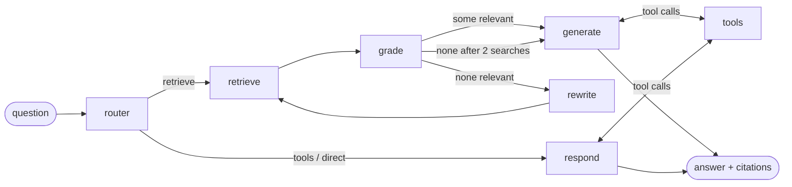

# Agentic RAG Assistant

A LangGraph agent that routes between vector retrieval (pgvector), tool calls, and grounded
answer synthesis with source citations — plus an evaluation harness that measures retrieval
accuracy and hallucination.

**Stack:** Python · LangGraph · Postgres + pgvector · Gemini API · FastAPI · React

## Build plan

| Part | Scope | Status |
|---|---|---|
| 1 | Foundation: config, Postgres + pgvector (Docker), schema | ✅ |
| 2 | Ingestion: load → chunk → embed → store | ✅ |
| 3 | Retrieval: vector + keyword (hybrid) search | ✅ |
| 4 | LangGraph agent: router, retrieval, tools, cited synthesis | ✅ |
| 5 | FastAPI backend (streaming chat, upload) | ✅ |
| 6 | React frontend | ✅ |
| 7 | Evaluation harness (retrieval metrics, groundedness) | ✅ |

## Layout

```
docker-compose.yml     Postgres 17 + pgvector
.env                   secrets & model config (copy from .env.example)
data/
  sources/             hand-written source text for the sample knowledge base
  corpus/              generated documents the assistant ingests (PDF, Markdown, TXT)
backend/
  requirements.txt
  app/
    config.py          settings loaded from .env
    db.py              schema + connection pool
    gemini.py          shared Gemini client (auto-retries 429/503)
    loaders.py         PDF / Markdown / TXT -> title + sections
    chunking.py        sections -> ~1200-char heading-aware chunks
    embeddings.py      Gemini embeddings (batched, normalised)
    ingest.py          pipeline: skip unchanged, embed, store atomically
    retrieval.py       hybrid search (pgvector + full-text, fused with RRF) + citations
    llm.py             Gemini chat models: CHAT_MODEL (answers), FAST_MODEL (decisions)
    memory.py          conversation memory: LangGraph checkpoints in Postgres
    api/
      main.py          FastAPI app, startup, CORS, /health
      chat.py          /chat, /chat/stream (SSE), /conversations/{id}
      documents.py     /documents: list, upload (ingests), delete
      schemas.py       request / response models
    agent/
      state.py         what flows between nodes
      prompts.py       router / grader / rewriter / answer prompts
      tools.py         calculator (safe, no eval), days_between, search_knowledge_base
      nodes.py         router, retrieve, grade, rewrite, generate, respond, tools
      graph.py         LangGraph wiring + ask()
      trace.py         readable step summaries (CLI --trace and API step events)
  scripts/
    init_db.py         create / reset tables
    check_setup.py     smoke test for DB + Gemini
    generate_corpus.py render data/sources -> data/corpus
    ingest.py          CLI for the ingestion pipeline
    search.py          CLI: search / compare retrieval modes
    chat.py            CLI: chat with the agent (--trace shows every step)
  eval/
    dataset.jsonl      41 questions: reference answers, key facts, labelled source sections
    metrics.py         hit@k, recall@k, MRR, key-fact check, hallucination & refusal rules
    systems.py         closed_book / plain_rag / agent behind one interface
    judge.py           LLM judge: verdict + claims the evidence doesn't support
    retrieval.py       CLI: retrieval metrics per search mode
    answers.py         CLI: answer evaluation (resumable, rate-limited)
    report.py          writes eval/REPORT.md from saved results
  tests/               pytest: loaders, chunking, retrieval, tools, agent, api, eval
frontend/              Vite + React + TypeScript chat UI
  src/
    api.ts             API client; streamChat() reads the SSE stream
    sse.ts             incremental Server-Sent Events parser (+ sse.test.ts)
    useChat.ts         conversation state: send (streaming), stop, open, reset
    conversations.ts   sidebar list in localStorage
    App.tsx            layout, URL #conversation-id, panels
    components/        ChatView, Steps, Answer (citations), SourcePanel, DocumentsPanel, Sidebar
```

## Setup

```bash
# 1. Start Postgres + pgvector
docker compose up -d

# 2. Install Python deps (Python 3.12+)
python3 -m venv .venv && source .venv/bin/activate
pip install -r backend/requirements.txt

# 3. Configure — put your Gemini key in .env
cp .env.example .env

# 4. Create tables and verify everything connects
cd backend
python -m scripts.init_db
python -m scripts.check_setup

# 5. Ingest the sample corpus
python -m scripts.ingest
```

## Sample knowledge base

`data/corpus/` holds 12 internal documents of **Brindlewave B.V.**, a fictional company that sells
**Tally**, a warehouse inventory system (shelf-weight sensors, gateway hub, cloud dashboard, REST API).
Because the company is made up, Gemini can't answer from its training data — a correct answer
has to come from retrieval, which is what makes the hallucination evaluation meaningful.

| Format | Documents |
|---|---|
| PDF | employee handbook, HR policy memo, hardware manual, pricing & plans, security & compliance, incident postmortem |
| Markdown | company overview, API reference, release notes, engineering onboarding, support FAQ |
| TXT | product meeting notes |

Deliberate challenges for the agent and the eval:

- **Superseded facts** — the Feb 2026 HR memo overrides the handbook (PTO carryover 5 → 8 days, learning budget €1,500 → €2,000).
- **Multi-hop questions** — e.g. "What's the API rate limit on the plan with a 99.9% SLA?" needs pricing + API docs.
- **Tables in PDFs** — pricing tiers, LED codes and SLA credits extract as messy text.
- **Repeated PDF headers/footers** — noise that ingestion should strip.
- **Confidential vs. public** — the meeting notes contain an unannounced price change.

Regenerate after editing `data/sources/`:

```bash
cd backend && python -m scripts.generate_corpus
```

## Ingestion (Part 2)

```
file ─► loaders.py ─► chunking.py ─► embeddings.py ─► ingest.py ─► Postgres
        clean text,   ~1200-char      Gemini, batched,   skip unchanged,
        sections,     chunks with     RETRIEVAL_DOCUMENT  replace chunks in
        page numbers  headings inline                     one transaction
```

- **PDF cleanup** uses font sizes from `pypdf`: larger-than-body text is a heading; small text at
  page edges (or lines repeated across pages) is a running header/footer and is dropped.
- **Chunks** merge small neighbouring sections and split long ones at paragraph → line → sentence
  boundaries with 150 chars of overlap. Each chunk starts with its section heading, and is embedded
  with the document title prepended, so it's self-describing when retrieved alone.
- **Idempotent:** `documents.content_hash` covers the file bytes *and* the pipeline settings
  (embedding model, dimension, chunk size, `PIPELINE_VERSION`), so changing any of them
  re-processes affected files automatically; unchanged files are skipped.

```bash
python -m scripts.ingest --dry-run --show-chunks   # inspect chunks, no API calls
python -m scripts.ingest                           # embed + store (skips unchanged)
python -m scripts.ingest --force --prune           # re-embed all, drop deleted files
python -m pytest                                   # run tests
```

## Retrieval (Part 3)

`search(query, k=5, mode="hybrid")` in `app/retrieval.py` runs two searches and merges them:

- **Vector** — cosine distance on the embeddings (`<=>`, HNSW index). Understands meaning:
  "vacation" finds "paid time off".
- **Keyword** — Postgres full-text search over chunk text + document title. Exact tokens such as
  `INC-2026-031`, `TT-200C`, `insufficient_scope`. Query words are OR-ed (not AND-ed) and ranked with `ts_rank`.
- **Reciprocal Rank Fusion** — `score = Σ 1/(60 + rank)`. Uses positions only, so cosine and
  `ts_rank` scores never need to be put on the same scale. Each retriever contributes its top 10.

Each result carries a `citation` such as `Tally Pricing and Plans 2026 › 4. SLA credits (pp. 1–2)`.

```bash
python -m scripts.search "How many PTO days can I carry over?"
python -m scripts.search "What caused the March outage?" --compare   # vector vs keyword vs hybrid
python -m scripts.search "TT-200C temperature" --mode keyword --full
```

Tuning notes from a 10–11 question spot-check (Part 7 will measure this properly):

| Setting | Finding |
|---|---|
| Candidates per retriever 20 → **10** | With 20 of 39 chunks per list, weak keyword matches that also sat low in the vector list outranked a strong vector-only hit. 10 fixed it. |
| Title in keyword index, **normal weight** | Without it the postmortem wasn't findable by its ID (only in its title). Boosting the title over-rewarded generic words like "plan". |
| Hybrid vs vector | Roughly even on this small corpus (MRR 0.955 vs 0.950); keyword search is insurance for rare tokens. |

## Agent (Part 4)



| Node | Model | Does |
|---|---|---|
| `router` | FAST | `retrieve` (company questions) / `tools` (pure math, dates) / `direct` (small talk); rewrites follow-ups into a standalone query using the conversation |
| `retrieve` | – | hybrid `search(query, k=6)` |
| `grade` | FAST | keeps only passages that help answer; search always returns *something*, this drops the noise |
| `rewrite` | FAST | new wording when nothing was relevant (one retry) |
| `generate` | CHAT | answers **only** from numbered sources, citing `[n]`; prefers newer documents when sources conflict. If there are no relevant sources it refuses with a fixed message and **no model call** |
| `respond` | CHAT | small talk / pure calculations, no documents |
| `tools` | – | runs `calculator` (AST-based, never `eval`), `days_between`, `search_knowledge_base` (results become new numbered sources) |

```bash
python -m scripts.chat                                   # interactive, remembers the conversation
python -m scripts.chat --trace "How many PTO days can I carry over?"
RUN_AGENT_TESTS=1 python -m pytest tests/test_agent.py  # live agent tests (use Gemini quota)
```

Example trace:

```
· 1.4s router   route=retrieve  query='PTO carry over policy unused days into next year'
· 0.7s retrieve 6 results for '…'
· 1.2s grade    relevant: [1] Employee Handbook › 2. Paid time off; [2] Memo: 2026 Changes › 1. PTO carryover
· 1.0s generate answered (cites [1, 2])
assistant> You can carry over up to 8 unused PTO days … (replacing the previous 5-day limit) [1][2]
```

**Gemini quotas.** Free-tier keys get a small *per-model, per-day* request quota (20/day for
`gemini-3.5-flash` at the time of writing). Routing, grading and rewriting run on `FAST_MODEL`
(`gemini-3.5-flash-lite`), so a question costs 1–2 `CHAT_MODEL` calls. With `THINKING_LEVEL=minimal`
a question takes ~4–8 s; higher thinking levels were 5–20× slower in testing.

## API (Part 5)

```bash
cd backend && ../.venv/bin/uvicorn app.api.main:app --reload --port 8000
# interactive docs: http://localhost:8000/docs
```

| Endpoint | Does |
|---|---|
| `POST /chat` | `{message, conversation_id?}` → `{conversation_id, answer, citations, route, queries}` |
| `POST /chat/stream` | Same input; Server-Sent Events while the agent works (below) |
| `GET /conversations/{id}` | Messages of a conversation, with citations (restore a chat after reload) |
| `DELETE /conversations/{id}` | Forget a conversation |
| `GET /documents` | Documents with format, pages, chunk count, ingest time |
| `POST /documents` | Multipart upload (`files`), saved to `data/uploads/` and ingested immediately; same name again = update |
| `DELETE /documents/{id}` | Remove a document and its chunks (and the file, for uploads) |
| `GET /health` | Database counts and configured models |

Stream events, in order:

| Event | Data |
|---|---|
| `meta` | `{conversation_id}`: send it back with the next message to continue the conversation |
| `step` | `{node, label, …}` after each agent step, e.g. `"Searched for 'API rate limit Growth plan': 6 results"` |
| `token` | `{text}`: the answer as the model writes it |
| `answer` | Final `{answer, citations, …}`; replaces the streamed tokens |
| `error` | `{message}` instead of `answer` if the run failed (e.g. Gemini quota) |

```bash
curl -N -X POST localhost:8000/chat/stream -H 'Content-Type: application/json' \
     -d '{"message": "What is the API rate limit on the Growth plan?"}'
```

Notes:

- **Memory** is LangGraph's `PostgresSaver`: the agent's state is checkpointed per `conversation_id`
  (LangGraph's `thread_id`) in the `checkpoint*` tables, so conversations survive restarts.
- **Uploads** are validated: base filename only (blocks `../` path traversal), supported types only,
  20 MB max. Ingestion runs inside the request (a few seconds per file).
- Endpoints are plain `def`, so FastAPI runs them in its thread pool; the agent and database code
  stay synchronous.
- **No authentication** and CORS only for the local React dev server: this is a local development
  setup, not something to expose publicly.

## Frontend (Part 6)

```bash
# terminal 1: the API
cd backend && ../.venv/bin/uvicorn app.api.main:app --reload --port 8000
# terminal 2: the UI
cd frontend && npm install && npm run dev      # http://localhost:5173
```

- **Live agent steps** while it works ("Searched for …", "Kept 2 relevant", "Calling calculator(…)"),
  collapsing to a summary (`6 steps · 25.4s · retrieve`) when the answer is done.
- **Streaming answers** rendered as Markdown; each `[n]` is a button that opens the **source panel**
  with the exact passage, so answers can be checked against their sources.
- **Conversations** listed in the sidebar (browser `localStorage`); the open one is in the URL
  (`#<conversation-id>`), so a reload restores it from the API's Postgres memory.
- **Documents panel**: list, drag-and-drop upload (ingested immediately), delete.
- Light and dark mode; a slide-in sidebar on phones.

The browser's `EventSource` only supports GET, and `/chat/stream` is a POST, so `api.ts` reads the
response with `fetch` and parses events with `sse.ts`, which is unit-tested against events split at
any byte (`npm test`). Set `VITE_API_URL` if the API isn't at `http://localhost:8000`.

## Evaluation (Part 7)

```bash
cd backend
../.venv/bin/python -m eval.retrieval        # retrieval metrics (embeddings only, cheap)
../.venv/bin/python -m eval.answers          # answer quality: closed_book vs plain_rag vs agent
../.venv/bin/python -m eval.report           # rebuild eval/REPORT.md from saved results
```

Full results: **[backend/eval/REPORT.md](backend/eval/REPORT.md)**. Headline numbers (one run,
41 questions, answers and judge on gemini-3.5-flash-lite):

| | closed_book | plain_rag | agent |
|---|---|---|---|
| Accuracy (answerable) | 13% | 100% | 97% |
| Hallucination rate | **90%** | **0%** | **2%** |
| Declined unanswerable questions | 0% | 100% | 100% |
| Answers with a citation | – | 89% | 100% |
| LLM calls / latency per question | 1 / 5.0 s | 1 / 6.9 s | 3.3 / 17.9 s |

Retrieval (35 answerable questions): hybrid hit@1 **97%**, MRR 0.986 (vector 94% / 0.967,
keyword 86% / 0.921).

What this shows, honestly: **grounding in retrieved documents is what removes hallucination**
(90% → 0–2%). On this small, clean corpus, retrieval is near-perfect, so the agent's grading and
rewriting have little to fix and plain RAG is just as accurate at a third of the cost; the one
agent miss is a reasoning slip (it called 18% larger than 25%), within run-to-run noise. The agent
cited every answer and refused 4 of 6 unanswerable questions without calling the answer model; its
extra machinery should matter more with noisier retrieval, harder calculations and follow-ups.

**Test set** (`eval/dataset.jsonl`): 41 questions in 9 categories (facts, paraphrases, exact
identifiers, PDF tables, superseded policies, multi-hop, arithmetic, date math, and 6 unanswerable
questions), each with a reference answer, key facts and the document sections that contain it.
Labels name a document + heading rather than a chunk id, so they survive re-chunking; a test checks
that every label matches a chunk in the database.

**Retrieval**: hit@1/3/5, recall@5 and MRR for vector, keyword and hybrid search.

**Answers**: three systems with the same answer model:

- `closed_book`: the model alone. Shows what it invents about a company it has never seen.
- `plain_rag`: one hybrid search + one answer call with the same grounding/citation rules.
- `agent`: the full LangGraph agent (routing, relevance grading, rewrite, tools, deterministic refusal).

An LLM judge grades each answer against the reference (correct / partial / incorrect / refused)
and lists every claim **not supported by the passages and tool results that system actually saw**.
Hallucination rate = answers with ≥1 unsupported claim, or any answer to an unanswerable question.
A deterministic key-fact check cross-checks the judge.

**Free-tier friendly**: answers and grading default to `FAST_MODEL` (gemini-3.5-flash-lite),
calls are rate-limited (`--rpm`), every result is saved as it's produced, and re-running resumes
after a quota error. `--answer-model gemini-3.5-flash` evaluates the production answer model.

## Browsing the database

`docker compose up -d` also starts **pgAdmin** at http://localhost:5050 (no pgAdmin login; local use only).
The connection is pre-registered: **Servers → RAG Postgres (pgvector)**, password `rag`
(tick "Save password"). Then **Databases → rag → Schemas → public → Tables**; right-click a table
→ *View/Edit Data*, or open *Tools → Query Tool* and try:

```sql
-- Documents with their chunk counts
SELECT d.id, d.title, d.metadata->>'format' AS format, count(c.id) AS chunks
FROM documents d LEFT JOIN chunks c ON c.document_id = d.id
GROUP BY d.id ORDER BY d.id;

-- The chunks of one document
SELECT chunk_index, metadata->'headings' AS headings, metadata->'pages' AS pages, left(content, 200) AS preview
FROM chunks WHERE document_id = (SELECT id FROM documents WHERE source LIKE '%pricing%')
ORDER BY chunk_index;

-- Peek at embeddings (768 numbers each; don't SELECT the whole column)
SELECT id, vector_dims(embedding) AS dims, (embedding::real[])[1:4] AS first_4_numbers FROM chunks LIMIT 5;

-- Keyword search on the generated tsvector column
SELECT d.title, left(c.content, 120) AS preview
FROM chunks c JOIN documents d ON d.id = c.document_id
WHERE c.tsv @@ websearch_to_tsquery('english', 'carryover');
```

Inside Docker, pgAdmin reaches Postgres at host `db` (the compose service name); from your Mac,
tools use `localhost:5432`. Terminal alternative: `docker exec -it rag-postgres psql -U rag -d rag`.

## Data model

- **documents** — one row per source file (`source`, `title`, `content_hash` for skipping unchanged files).
- **chunks** — text pieces of a document with a `vector(768)` embedding (HNSW cosine index) and a
  generated `tsvector` column (GIN index) so we can combine semantic and keyword search.
